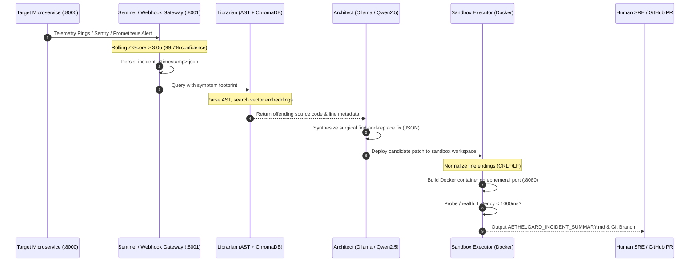

<div align="center">

# 🛡️ AETHELGARD
### **Autonomous, Local-First AI Site Reliability Engineer (AI-SRE) & Self-Healing Framework**

*Detect runtime performance regressions. Isolate root-cause code via AST & Vector RAG. Synthesize surgical non-blocking patches with a local LLM. Validate inside an isolated Docker sandbox before human review. 100% Air-Gapped. Zero Cloud Spend.*

---

[](https://github.com/SoumyaRoy05/Aethelgard/actions)
[](https://www.python.org/)
[](https://fastapi.tiangolo.com/)
[](https://www.docker.com/)
[](https://ollama.com/)
[](#zero-cost-production-stack)

</div>

---

## 🌟 What is Aethelgard?

**Aethelgard** is an autonomous, local-first **AI Site Reliability Engineer (AI-SRE)**.

When microservices suffer performance degradation (such as event-loop starvation, synchronous blocking I/O, or CPU spin loops), human engineers are usually paged at 2 AM to spend hours triaging metrics, locating the bad commit, and writing a hotfix.

**Aethelgard automates this entire lifecycle in under 60 seconds:**
1. **Detects** latency anomalies in real-time using rolling 3-sigma ($3\sigma$) Z-score statistics or external webhooks (Sentry / Prometheus).
2. **Isolates** the exact offending function or route handler in source code using Python Abstract Syntax Trees (AST) and local vector embeddings (ChromaDB + MiniLM).
3. **Synthesizes** an exact, non-blocking code replacement using an air-gapped, local open-weights code LLM (`qwen2.5-coder:7b` via Ollama).
4. **Validates** the patch inside an isolated Docker container sandbox on an ephemeral port to mathematically verify latency normalization before human sign-off.
5. **Generates** a human-auditable markdown incident report, structured JSON log, and a prepared Git branch for one-click deployment.

> [!IMPORTANT]
> **Zero Cloud Spend & 100% Privacy:** No telemetry, source code, or incident snapshots leave your infrastructure. Embedding computation, vector search, LLM inference, and container validation run 100% locally or inside your private VPC.

---

## 🏗️ The 5-Stage Closed-Loop Architecture



---

## 📦 Directory Structure

```
Aethelgard/
├── .github/workflows/ci.yml         # Free GitHub Actions continuous integration pipeline
├── docker-compose.yml               # Complete zero-cost multi-service local stack
├── requirements.txt                 # Core Python package dependencies
├── .env.example                     # Environment configuration blueprint
├── verify_project.py                # Pre-flight environment & integrity audit tool
├── orchestrator.py                  # Master autonomous closed-loop AI-SRE workflow engine
│
├── gateway/                         # Ingestion Gateway Layer
│   ├── __init__.py
│   └── webhook_receiver.py          # FastAPI receiver for Sentry, Prometheus & Datadog alerts
│
├── sentinel/                        # Telemetry & Statistical Anomaly Layer
│   └── sentinel_engine.py           # PolishedSentinel: Rolling 3-sigma Z-Score anomaly engine
│
├── librarian/                       # Semantic Retrieval Layer (RAG)
│   ├── __init__.py
│   └── librarian_engine.py          # AST parser, MiniLM embeddings & ChromaDB indexing
│
├── architect/                       # Reasoning & Patch Synthesis Layer
│   ├── __init__.py
│   └── architect_engine.py          # LocalRemediationArchitect: Ollama Qwen2.5-Coder connector
│
├── executor/                        # Sandboxed Container Validation Layer
│   ├── __init__.py
│   └── executor_engine.py           # Multi-tier patch applicator, Docker build & probe harness
│
├── target_service/                  # Target Microservice & Chaos Simulator
│   ├── Dockerfile                   # Hermetic container configuration (python:3.10-slim)
│   └── app/
│       ├── config.py                # In-memory system state & active chaos tracking
│       ├── main.py                  # FastAPI app with /health and /metrics (Prometheus)
│       └── sabotage.py              # Chaos endpoints (/sabotage/blocking-io, /fix, etc.)
│
├── tests/                           # Automated Pytest Suite
│   ├── __init__.py
│   ├── test_sentinel.py             # Z-score math, cold-start, & zero-variance tests
│   ├── test_architect.py            # JSON extraction & rule fallback tests
│   ├── test_executor.py             # Exact & fuzzy line patching tests
│   └── test_target_service.py       # FastAPI routes & chaos triggers tests
│
└── reports/                         # Auditing & Vector Mounts
    ├── incident_reports/            # Raw JSON incident dumps
    │   └── processed/               # Archived processed incident snapshots
    ├── audit_logs/                  # Structured audit JSONs & git diff patches
    ├── chroma_storage/              # Persistent local vector database files
    └── AETHELGARD_INCIDENT_SUMMARY.md # Latest human-auditable incident report
```

---

## ⚡ Quickstart Guide (3 Minutes)

### 1. Prerequisites
* **Python 3.10+**
* **Docker Desktop** installed and running
* **Ollama** running locally:
  ```bash
  ollama pull qwen2.5-coder:7b
  ```

### 2. Installation
```bash
# Clone the repository
git clone https://github.com/SoumyaRoy05/Aethelgard.git
cd Aethelgard

# Install dependencies
pip install -r requirements.txt

# Verify project integrity
python verify_project.py
```

### 3. Run the Live Autonomous Self-Healing Drill

Open three terminal windows:

#### **Terminal 1: Start the Target Service**
```bash
uvicorn target_service.app.main:app --port 8000
```

#### **Terminal 2: Start the Sentinel Monitor**
```bash
python sentinel/sentinel_engine.py
```

#### **Terminal 3: Trigger Chaos & Run Orchestrator**
```bash
# 1. Trigger the blocking I/O incident (latency spikes to 1200ms+)
curl -X POST http://127.0.0.1:8000/sabotage/blocking-io

# 2. Run the Autonomous Orchestrator (or use --daemon for continuous monitoring)
python orchestrator.py
```

**What Happens:**
* Sentinel detects $|Z| > 3.0\sigma$ and writes an incident JSON.
* Orchestrator extracts the symptom trace and queries ChromaDB.
* Librarian pinpoints `time.sleep(1.2)` inside `target_service/app/main.py`.
* Architect prompts Ollama (`qwen2.5-coder:7b`) to generate `await asyncio.sleep(0.01)`.
* Executor clones the codebase to a sandbox, applies the fix, builds Docker on port `8080`, and probes `/health`.
* Once verified healthy, generates `reports/AETHELGARD_INCIDENT_SUMMARY.md` and prepares a Git branch.

---

## 🐳 Zero-Cost Multi-Service Docker Compose

Run the entire ecosystem in isolated containers with a single command:

```bash
docker compose up --build
```

Services exposed:
* **Target Microservice**: `http://localhost:8000` (Endpoints: `/health`, `/metrics`, `/sabotage/*`)
* **Webhook Gateway**: `http://localhost:8001` (Endpoints: `/webhook/sentry`, `/webhook/prometheus`, `/incidents`)
* **Sentinel Engine**: Background container continuously monitoring `target-service:8000`.

---

## 🔗 Enterprise Webhook Ingestion

Aethelgard includes a dedicated Ingestion Gateway (`gateway/webhook_receiver.py`) to connect external APMs:

### Sentry Integration
Point your Sentry project webhook to:
```
POST http://<your-aethelgard-host>:8001/webhook/sentry
```
Extracts issue title, culprit file, line number, and stack trace directly into the remediation loop.

### Prometheus Alertmanager Integration
Add to your `alertmanager.yml`:
```yaml
receivers:
  - name: 'aethelgard'
    webhook_configs:
      - url: 'http://<your-aethelgard-host>:8001/webhook/prometheus'
        send_resolved: true
```

---

## 🧪 Automated Testing

Aethelgard features a full automated test suite covering statistical anomaly math, AST slicing, LLM parsing, and container sandbox patching:

```bash
pytest tests/ -v
```

---

## 💼 Startup Viability & Market Strategy

### The Market Opportunity
Cloud downtime costs businesses **\$5,000 to \$50,000 per minute**. On-call engineers face severe burnout from triaging repetitive performance alerts.

### The Problem with Cloud AI Tools
Most AI coding assistants (Copilot, Cursor) require transmitting proprietary code and production metrics to third-party cloud APIs (OpenAI/Anthropic). Regulated enterprises (FinTech, HealthTech, Defense, Banking) **cannot** do this due to HIPAA, SOC 2, and GDPR constraints.

### Aethelgard's Defensible Moats
1. **100% Air-Gapped & Local-First:** Runs on the customer's private workstation, on-premise hardware, or sovereign VPC. Zero data leakage.
2. **The Verification Engine ("Trust Moat"):** AI is never allowed to push unverified code to production. Every patch must compile and mathematically normalize latency in a Docker sandbox before human review.
3. **The 2 AM Incident Copilot Wedge:** Rather than pitching risky "fully autonomous production writes," sell peace of mind: **A verified GitHub Pull Request ready for review before the engineer wakes up.**

---

## 📄 License

Distributed under the MIT License. See `LICENSE` for more information.

---

<div align="center">
<b>Built with 🛡️ for resilient, self-healing distributed systems.</b>
</div>
